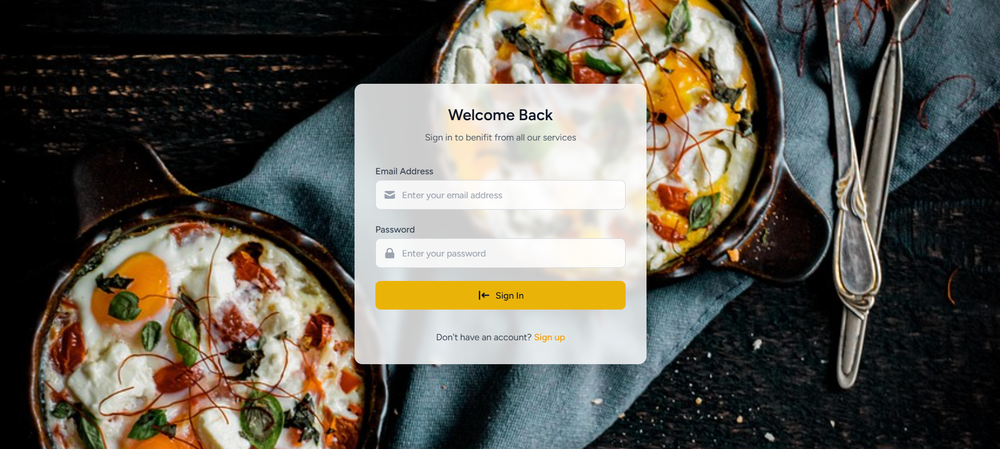
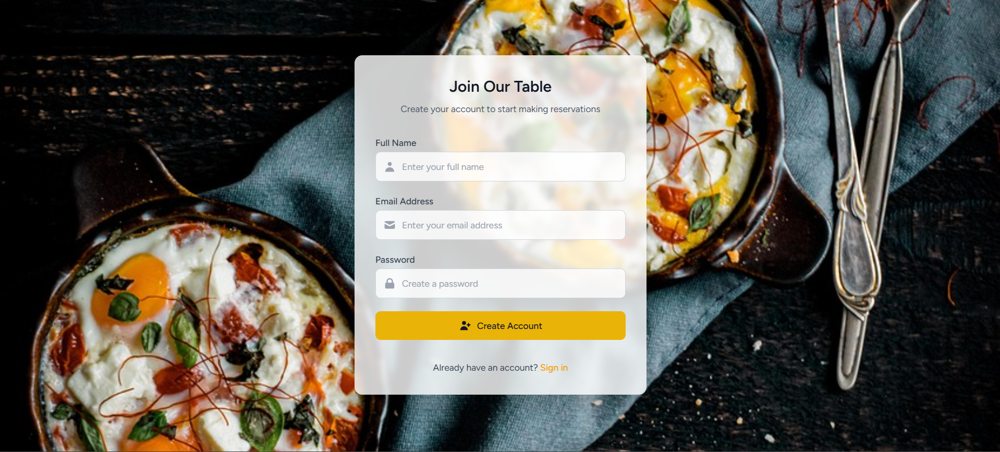
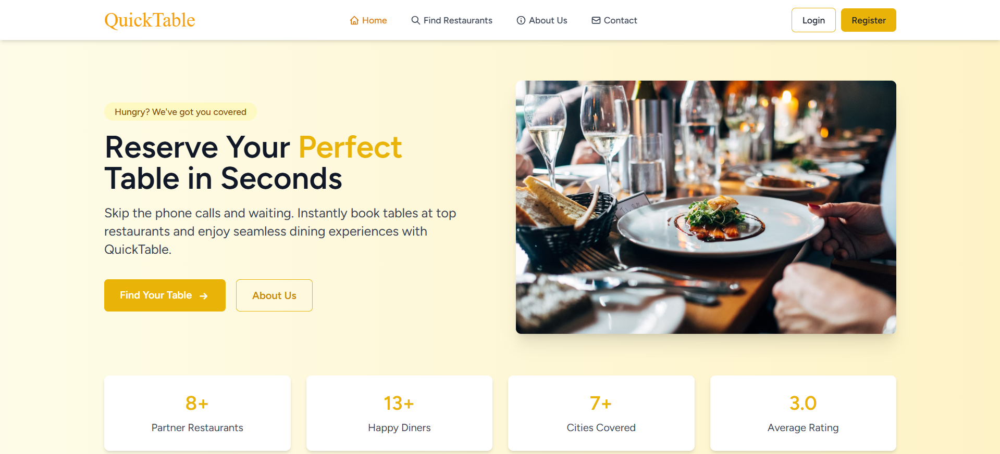
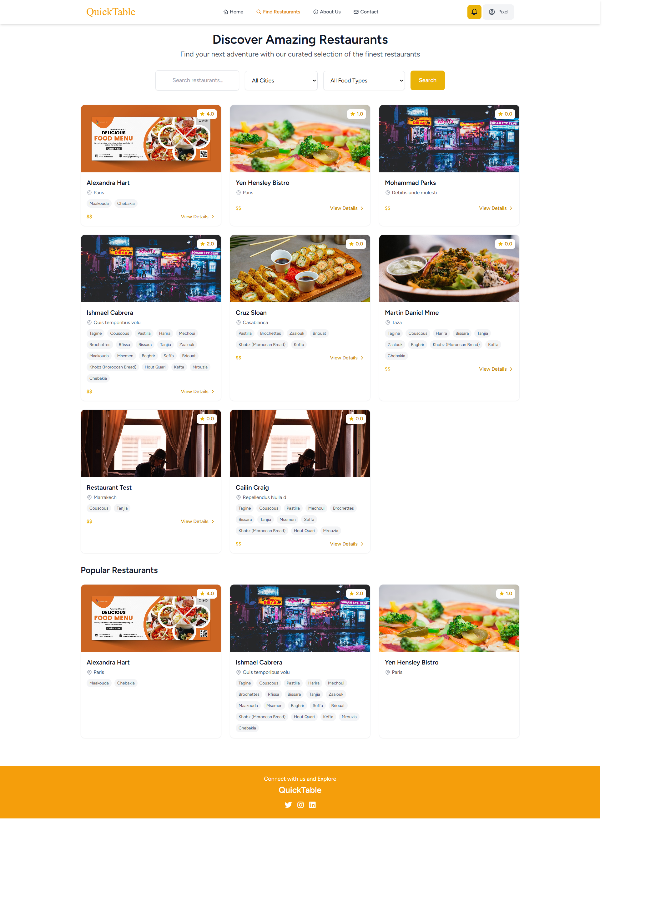
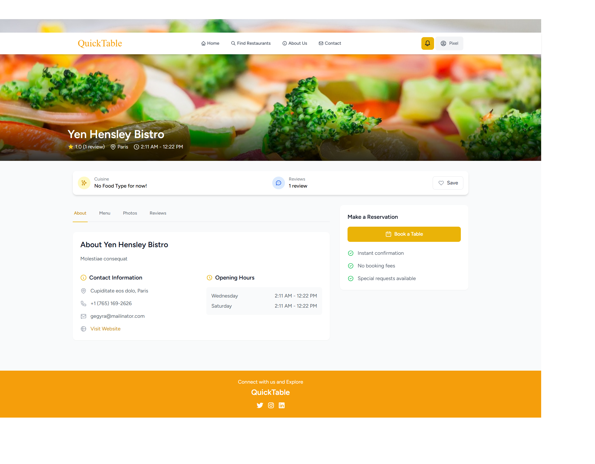
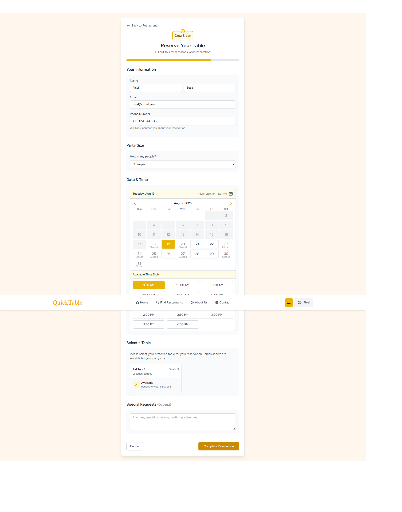
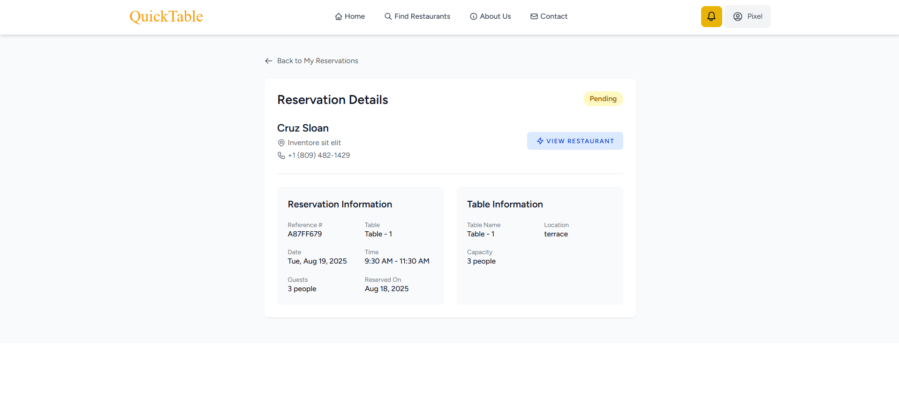

# 🍽️ QuickTable - Restaurant Reservation System

[](https://laravel.com)
[](https://php.net)
[](https://tailwindcss.com)
[](https://sqlite.org)

QuickTable is a modern, full-featured restaurant reservation system that connects diners with restaurants for seamless table booking experiences. Built with Laravel 11 and featuring a responsive design with Tailwind CSS.

## 🌟 Features

### For Customers
- **Easy Restaurant Discovery**: Browse restaurants by location, cuisine, and availability
- **Instant Reservations**: Book tables in seconds with real-time availability
- **Reservation Management**: View, modify, and cancel reservations
- **Restaurant Reviews**: Read and write reviews for restaurants
- **Favorites System**: Save favorite restaurants for quick access
- **Real-time Notifications**: Get updates on reservation status

### For Restaurant Managers
- **Restaurant Profile Management**: Complete restaurant setup with images, menus, and operating hours
- **Table Management**: Configure tables with capacity and availability
- **Reservation Control**: Approve, decline, or manage customer reservations
- **Menu Management**: Create and manage restaurant menus with food categories
- **Dashboard Analytics**: View reservation statistics and restaurant performance
- **Notification System**: Receive alerts for new reservations

### For Administrators
- **User Management**: Manage customers and restaurant managers
- **Restaurant Approval**: Review and approve new restaurant registrations
- **Platform Analytics**: Monitor platform usage and performance
- **Content Moderation**: Manage reviews and restaurant content

## 🏗️ System Architecture

The application follows Laravel's MVC architecture with the following key components:

### Models
- **User**: Handles authentication for customers, managers, and admins
- **Restaurant**: Restaurant information and settings
- **Table**: Restaurant table configurations
- **Reservation**: Booking management system
- **Menu & MenuItem**: Restaurant menu system
- **Review**: Customer review system
- **Favorite**: User favorites functionality

### Controllers
- **Client Controllers**: Handle customer-facing operations
- **Manager Controllers**: Restaurant management operations
- **Admin Controllers**: Administrative functions
- **Auth Controllers**: Authentication and authorization

## 📸 Screenshots









## 🚀 Installation & Setup

### Prerequisites
- PHP >= 8.2
- Composer
- Node.js & NPM

### Step 1: Clone the Repository
```bash
git clone https://github.com/Pood16/Reserva.git
cd newQuickTable
```

### Step 2: Install Dependencies
```bash
# Install PHP dependencies
composer install

# Install Node.js dependencies
npm install
```

### Step 3: Environment Configuration
```bash
# Copy environment file
cp .env.example .env

# Generate application key
php artisan key:generate
```

### Step 4: Database Setup
```bash


# Run migrations
php artisan migrate

# Seed the database (optional)
php artisan db:seed
```

### Step 5: Build Assets
```bash
# Build frontend assets
npm run build

# Or for development with hot reload
npm run dev
```

### Step 6: Storage Setup
```bash
# Create storage symlink for file uploads
php artisan storage:link
```

### Step 7: Start the Application
```bash
# Start the Laravel development server
php artisan serve
```

The application will be available at `http://localhost:8000`


## 🎯 Usage Guide

### For Customers
1. **Registration**: Create an account as a customer
2. **Browse Restaurants**: Use the search and filter features
3. **Make Reservations**: Select date, time, and party size
4. **Manage Bookings**: View and manage your reservations in your profile

### For Restaurant Managers
1. **Registration**: Request manager access through the platform
2. **Restaurant Setup**: Create your restaurant profile with details and images
3. **Table Configuration**: Set up your restaurant tables and capacity
4. **Menu Management**: Add menus and menu items
5. **Reservation Management**: Handle incoming reservations

### For Administrators
1. **Manager Approval**: Review and approve restaurant manager requests
2. **Platform Monitoring**: Monitor system usage and performance
3. **Content Management**: Moderate reviews and restaurant content


**QuickTable** - Connecting diners with restaurants, one reservation at a time. 🍽️✨
